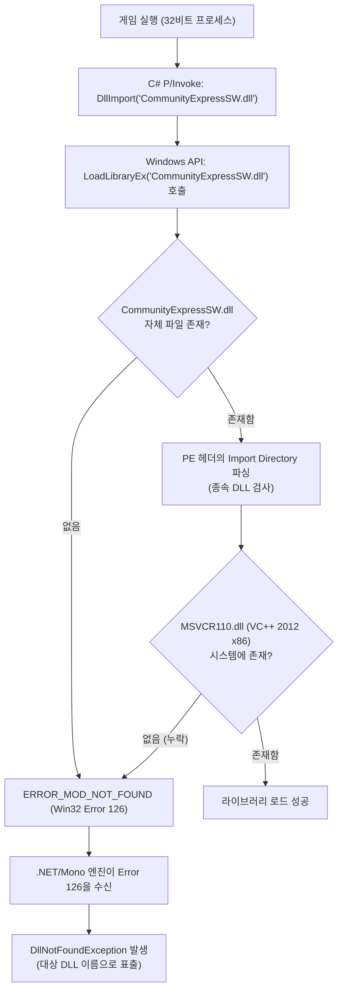

# 🔍 실전 트러블슈팅 가이드 (Troubleshooting Guide)

이 문서는 게임 및 애플리케이션 실행 중 자주 마주치는 **"가짜 `DllNotFoundException`"**과 **런타임 종속성 문제**의 원인을 심층 분석하고, **Visual Support Tool**을 통해 이를 진단하고 해결하는 방법을 설명합니다.

---

## 📌 1. 핵심 문제: "DLL 파일이 폴더에 멀쩡히 있는데 왜 찾을 수 없다고 할까?"

Unity 게임(Mono/Il2Cpp 기반), 스팀 게임, 혹은 모딩 도구를 실행할 때 다음과 같은 에러 로그를 마주하는 경우가 매우 많습니다.

```text
Fallback handler could not load library .../Ziggurat_Data/Plugins/CommunityExpressSW.dll
DllNotFoundException: H:/steam/steamapps/common/Ziggurat/Ziggurat_Data/Plugins/CommunityExpressSW.dll
  at (wrapper managed-to-native) CommunityExpressNS.CommunityExpress:SteamUnityAPI_Init (intptr,intptr)
  at CommunityExpressNS.CommunityExpress.Initialize ()
  at Milkstone.Game.Steam.SteamPlatformInterface._Init (Int32 appId)
```

사용자가 직접 에러 메시지에 적힌 경로(`Plugins/CommunityExpressSW.dll`)를 열어보면, **해당 파일은 이미 그 자리에 정확히 존재**합니다. 그럼에도 불구하고 엔진은 왜 `DllNotFoundException`을 뱉어낼까요?

---

## ⚙️ 2. Windows OS의 DLL 로딩 메커니즘과 Error 126의 진실

이 현상의 근본 원인은 **Windows 운영체제의 동적 링크 라이브러리(DLL) 로딩 방식**과 **.NET/Mono 런타임의 에러 처리 구조**에 있습니다.



### 1) Win32 API의 `ERROR_MOD_NOT_FOUND (126)`
Windows에서 `LoadLibrary` 또는 `LoadLibraryEx` 함수로 특정 DLL을 메모리에 로드할 때, 운영체제는 대상 DLL 파일만 검사하는 것이 아니라 **그 DLL이 필요로 하는 모든 종속 DLL(Dependent Libraries)**을 함께 찾아 로드합니다.

이때 **다음 두 경우 모두 Windows는 똑같이 `ERROR_MOD_NOT_FOUND` (에러 코드 126)를 반환**합니다:
1. 대상 DLL 파일 자체가 없을 때
2. 대상 DLL 파일은 있지만, **그 DLL이 참조하는 하위 종속 DLL(예: Visual C++ 런타임)이 시스템에 없을 때**

### 2) .NET / Mono 엔진의 오인
Mono 및 .NET 런타임은 Windows로부터 `ERROR_MOD_NOT_FOUND (126)`를 전달받으면, 하위 의존성이 빠진 것인지 최상위 파일이 빠진 것인지 구분하지 않고 무조건 **`DllNotFoundException: <호출한 DLL 경로>`** 예외를 발생시킵니다. 

이로 인해 사용자는 "파일이 분명히 있는데 왜 없다고 하지?"라는 혼란에 빠지게 됩니다.

---

## 🔎 3. 실전 사례 분석: Ziggurat (`CommunityExpressSW.dll`)

실제 발생 사례인 `Ziggurat` 게임의 `output_log.txt`를 정밀 분석해보면 다음과 같은 종속성 구조를 가집니다:

* **실행 파일(`Ziggurat.exe`) 아키텍처**: `x86 (32-bit)`
* **플러그인 파일(`CommunityExpressSW.dll`) 아키텍처**: `x86 (32-bit)`
* **PE Import 의존성 목록**:
  * `KERNEL32.dll` (Windows 기본 시스템 라이브러리)
  * `steam_api.dll` (Steam 클라이언트 통신 라이브러리)
  * **`MSVCR110.dll` 👈 Microsoft Visual C++ 2012 Redistributable (x86)**

### 💡 64비트 Windows 사용자가 겪는 함정
현대의 거의 모든 PC는 **64비트 Windows**를 사용합니다. 따라서 사용자는 보통 최신 64비트 프로그램용 런타임(VC++ 2015-2022 x64 등)만 설치해 두는 경우가 많습니다.

하지만 수많은 Steam 게임, 인디 게임, Unity 4.x/5.x 기반 게임, 그리고 고전 명작 타이틀들은 **32비트(x86)** 프로세스로 빌드되어 있습니다.
* **32비트 프로세스는 64비트 DLL을 로드할 수 없습니다.**
* 따라서 PC에 아무리 64비트 Visual C++ 런타임이 잘 깔려 있어도, **Visual C++ 2012 x86 (32비트)** 패키지가 누락되어 있다면 위와 같은 크래시가 100% 발생합니다.

---

## 🛠️ 4. Visual Support Tool을 통한 원클릭 진단 및 해결

**Visual Support Tool**은 바로 이러한 문제를 사전 진단하고 몇 초 만에 해결하기 위해 설계되었습니다.

1. **시스템 레지스트리 정밀 진단**:
   * 64비트와 32비트(`SysWOW64` / `Wow6432Node`) 레지스트리를 분리 검사하여, 누락된 버전(특히 **2012 x86, 2010 x86, 2008 x86**)을 명확하게 붉은색/경고 상태로 표시합니다.
2. **Steam 오프라인 캐시 우선 활용**:
   * `Steamworks Shared\_CommonRedist\vcredist`에 이미 보관된 설치 파일이 있다면 다운로드 없이 즉시 로컬에서 오프라인 사일런트 설치를 진행합니다.
3. **원클릭 사일런트(무인) 일괄 설치**:
   * **`[미설치 패키지 원클릭 설치]`** 버튼 클릭 한 번으로, 누락된 아키텍처의 패키지만 골라 백그라운드(`/quiet`, `/norestart`)에서 UAC 관리자 권한으로 자동 설치합니다.
4. **결과**:
   * `MSVCR110.dll`이 `C:\Windows\SysWOW64\`에 정상 배치되면서, 게임 실행 시 `CommunityExpressSW.dll`이 문제없이 로드되고 게임이 정상 구동됩니다.

---

## 📋 5. 런타임 설치 후에도 문제가 지속될 때 체크리스트

만약 Visual Support Tool을 통해 해당하는 Visual C++ x86/x64 런타임을 모두 설치했음에도 여전히 동일한 에러가 발생한다면 다음 항목을 점검하세요:

| 점검 항목 | 원인 및 해결 방법 |
| :--- | :--- |
| **Steam 클라이언트 실행 여부** | `steam_api.dll`은 백그라운드에서 실행 중인 Steam 클라이언트 프로세스와 IPC 통신을 시도합니다. Steam이 실행되어 있지 않거나 로그아웃된 상태라면 DLL 초기화(`SteamUnityAPI_Init`) 단계에서 실패할 수 있습니다. |
| **작업 디렉터리(Working Directory) 문제** | 바로가기나 외부 런처, 커스텀 스크립트로 게임을 실행할 때 '작업 폴더'가 게임 루트 디렉터리로 설정되지 않으면 `steam_api.dll`을 탐색하지 못할 수 있습니다. |
| **DirectX 9 / 그래픽 장치 유실 (`HandleD3DDeviceLost`)** | 로그에 `Skipped rendering frame because GfxDevice is in invalid state`가 반복되는 경우, 전체화면 해상도 불일치 또는 모니터 주사율 호환성 문제일 수 있으므로 창 모드(`-screen-fullscreen 0`) 옵션으로 실행해 보세요. |
